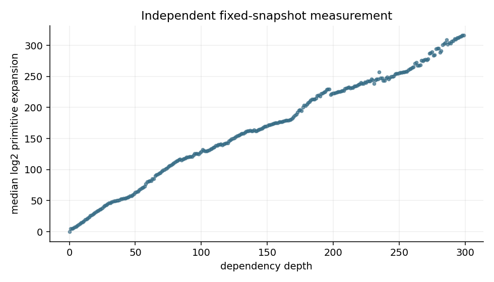

# MAAM · 命题数学兴趣指标计算器

输入一个有证明及依赖数据的形式命题，计算压缩、证明效率和结构用途，并给出可追溯的相对评分。
Evaluate a formal proposition using compression, proof efficiency, and structural usefulness, with a traceable relative score.

本项目根据 Freedman 参与的两篇论文实现研究用指标，已完成固定 Mathlib 快照的全量依赖导出、SCC 收缩、精确展开量及兴趣索引；与原文的数值差异和缺失测量均明确保留，人类兴趣标注验证尚未完成。
This project implements research metrics from two papers coauthored by Freedman, with a completed fixed-snapshot Mathlib export, SCC condensation, exact expansions, and interest index; numerical discrepancies and missing measurements remain explicit, and human-interest validation is unfinished.

## 下一阶段 / Next phase

项目的长期目标是评估新命题、新数学对象及围绕核心思想形成的理论包，并为 LLM 学习提供可核查的比较反馈。
The long-term goal is to evaluate new propositions, mathematical objects and theory packages built around a core idea, providing auditable comparative feedback for LLM learning.

拟议主线是加入候选后实际重述、重证已有结果，再比较用途与成本；首个实验及 skill 职责见 [研究计划](docs/RESEARCH_PLAN.md)，这些新能力尚未实现。
The proposed next phase introduces candidates, actually reformulates and reproves existing results, and compares usefulness and cost; see the [research plan](docs/RESEARCH_PLAN.md) for the first experiment and skill responsibilities, which are not yet implemented.

## 快速运行 / Quick start

需要 Python 3.11 或以上，计算核心没有第三方依赖，也不调用 LLM 或外部服务。
The core needs Python 3.11 or later, has no third-party dependencies, and makes no LLM or external service calls.

```bash
python -m maam score --corpus examples/paper_simple_lemma.json --name simple_lemma --format text
python -m maam rank --corpus examples/toy_corpus.json --format text
python -m maam efficiency --system examples/finite_proofs.json --name D
python -m unittest discover -s tests -v
```

也可在虚拟环境中执行 `pip install -e .`，随后用 `maam` 替换 `python -m maam`。
You may also run `pip install -e .` in a virtual environment and use `maam` instead of `python -m maam`.

实际运行的论文小例子 `A ∧ B → B` 返回 `T0 = 1`、`I0 = 4/3`；只有一个对照命题时，相对分按约定为 50，不能据此声称它具有中等数学价值。
The paper's small example `A ∧ B → B` returns `T0 = 1` and `I0 = 4/3`; a singleton comparison cohort receives 50 by convention, which does not establish middling mathematical value.

## 计算什么 / What is calculated

令 `Ws, Wb` 为命题和证明的 wrapped 长度，`Us, Ub` 为递归展开后的原始引用数。
Let `Ws, Wb` be the wrapped statement and proof lengths, and `Us, Ub` their recursively expanded primitive-reference counts.

| 输出 / Output | 定义 / Definition | 来源与状态 / Attribution and status |
| --- | --- | --- |
| `T0` | `(Us + Ub) / (Ws + Wb)` | ABFM §5；约化压缩 / reductive compression |
| `I0` | `Wb / Ws` | ABFM §5；演绎压缩 / deductive compression |
| `primitive_proof_to_statement` | `Ub / Us` | ABFM §5 脚注中的替代量 / footnote alternative |
| `I1` | 压缩偏置的加权 PageRank 平稳分布 / compression-biased weighted PageRank stationary mass | ABFM §5.1；归一化等操作约定见下 / operational choices below |
| `E_finite` | `min Σ statement_length / target_statement_length` | BDF §3.4.1 的有限树证明版本 / restricted finite tree-proof version |
| `score` | `I1` 在合格定理中的 midrank 百分位 / midrank percentile of `I1` among eligible theorems | 本项目的展示约定，非论文标定分数 / MAAM presentation convention |
| `direct_users`, `user_domains` | 直接使用者数量和模块类别 / direct users and module labels | 结构描述量；不额外混入综合分 / descriptive only |
| `reuse` | 多目标证明节省减去定理构造成本 / multi-goal savings minus construction cost | 本项目扩展，不冒充论文指标 / MAAM extension |

默认 `references` 模式用内部表达式中的引用数度量 wrapped 长度，这是原文 §3.2 讨论的替代口径。
The default `references` mode measures wrapped length using internal-expression references, an alternative discussed in §3.2.

它与论文实证图表采用的源代码 token 计数不同，尤其会受到 `simp` 等策略展开的影响。
It differs from the source-token measurement used for the paper's empirical figures, particularly when tactics such as `simp` elaborate into large proof terms.

如已取得真实的命题和证明 token 数，可提供 `source_tokens` 语料；程序不会用内部引用数替代缺失的 token 数。
If actual statement and proof token counts are available, supply a `source_tokens` corpus; missing token counts are never replaced with internal-reference counts.

完整定义和操作约定见 [指标说明](docs/METRICS.md)，输入格式见 [数据说明](docs/DATA.md)。
See [metric definitions](docs/METRICS.md) for the operational conventions and [data documentation](docs/DATA.md) for input formats.

## 输入你自己的命题 / Evaluate your own proposition

已有四个长度时，可直接计算压缩指标。
If you have the four measured lengths, calculate the compression metrics directly.

```bash
python -m maam metrics \
  --signature-wrapped 10 --body-wrapped 90 \
  --signature-unwrapped 100 --body-unwrapped 9000
```

这会得到 `T0 = 91`、`I0 = 9`；没有对照语料和依赖图时，不生成虚假的 `I1` 或综合分。
This returns `T0 = 91` and `I0 = 9`; without a comparison corpus and dependency graph, it does not fabricate an `I1` value or overall score.

已有形式命题语料时，用声明名称评分，或批量排序。
For a formal corpus, score a declaration by name or rank the corpus.

```bash
python -m maam validate examples/toy_corpus.json
python -m maam score --corpus examples/toy_corpus.json --name Toy.StructuralLemma
python -m maam rank --corpus examples/toy_corpus.json --alpha 0.85 --beta 0.5
```

`query` 只匹配语料中存储的原文；它不负责把任意自然语言自动形式化，也不根据命题的名气打分。
`query` matches stored statement text exactly; it does not automatically formalise arbitrary natural language or assign scores based on a proposition's fame.

```bash
python -m maam query --corpus examples/paper_simple_lemma.json --statement 'A ∧ B → B'
```

未匹配的命题和未证明的猜想会返回缺少的证据与空分数，退出码为 2。
Unmatched statements and unproved conjectures return the missing evidence and a null score, with exit code 2.

## Lean 接口 / Lean adapter

适配器从已有 Lean 工程导出命题类型、证明体及带重复次数的依赖；已通过 GitHub Actions 上 Lean 4.24.0 的小命题端到端检查。
The adapter exports statement types, proof bodies, and dependency multiplicities from an existing Lean project; it passes the small-proposition end-to-end check on Lean 4.24.0 in GitHub Actions.

小例检查包含真实证明导出、指标计算与 `sorry` 污染排除；全库实验的执行证据另见 [远程验证记录](results/remote_validation.json) 和 [实际报告](reports/mathlib/summary.json)。
The small cases check actual proof export, metric calculation, and exclusion of `sorry` taint; see the [remote validation record](results/remote_validation.json) and [measured report](reports/mathlib/summary.json) for the separate full-library experiment.

```bash
python -m maam export-lean --project /absolute/path/to/your/lean/project \
  --module YourModule --target YourNamespace.yourTheorem \
  --expand-prefix YourModule --output data/your-corpus.json
python -m maam score --corpus data/your-corpus.json --name YourNamespace.yourTheorem
```

工具链、边界设置、局部导出偏差与测试步骤见 [Lean 接口说明](lean/README.md)。
See the [Lean adapter guide](lean/README.md) for toolchains, primitive boundaries, local-export bias, and smoke checks.

全库实验使用独立的流式导出器 `maam/PaperExport.lean`，保留 unsafe 声明，收缩 SCC 并测量真实源码 token；运行方法与明确的过滤约定见 [固定快照复现说明](docs/REPRODUCTION.md)。
The full-library experiment uses the separate streaming exporter `maam/PaperExport.lean`, retains unsafe declarations, condenses SCCs, and measures actual source tokens; see the [fixed-snapshot reproduction guide](docs/REPRODUCTION.md) for commands and explicit filtering conventions.

工作流生成完整 SQLite 指标索引；下载并解压后，可直接查询固定语料中的命题，无需本地 Lean 工具链。
The workflow generates a complete SQLite metric index; after downloading and decompressing it, query propositions in the fixed corpus without a local Lean toolchain.

```bash
python -m maam score-index --index data/mathlib-metrics.sqlite \
  --name Hyperreal.infinitesimal_zero
```

## 已测得的 Mathlib 结果 / Measured Mathlib results

固定使用论文给出的提交 `d167cc6d` 和 Lean 4.24.0；下表区分模块范围内声明与为递推保留的基础依赖节点。
The experiment pins the paper's commit `d167cc6d` and Lean 4.24.0; the table distinguishes module-scope declarations from primitive boundary nodes retained for the recurrence.

| 测量 / Measurement | MAAM | 原文 / Paper |
| --- | ---: | ---: |
| Mathlib 声明，收缩前 / declarations before SCC | 463,719 | 463,719 |
| Mathlib 分量，收缩后 / components after SCC | 463,661 | 463,661 |
| 额外显式基础边界 / additional explicit primitive boundary | 9,626 | 未单列 / not separate |
| 最大深度 / maximum depth | 299 | ≈300 |
| 深度对中位 `log2 U` 的斜率 / depth-to-median-log2 slope | 0.9957 | ≈1 |
| 最大 `log10 U` / maximum log10 expansion | 110.6394 | ≈104 |
| token 对中位 `log2 U` 的斜率 / token-to-median-log2 slope | 0.2281 | ≈0.4 |
| 可评分已证明定理 / eligible proved theorems | 356,733 | 未报告 / not reported |

最大展开量对应同一条代数几何定理，但数值尚未一致；[依赖贡献表](reports/mathlib/max_expansion_dependencies.csv) 可用于逐层追查，程序不会调整引用次数来强行匹配。
The maximum occurs at the same algebraic-geometry theorem but its magnitude still differs; the [dependency contribution table](reports/mathlib/max_expansion_dependencies.csv) supports inspection without tuning reference counts to force agreement.

完整图保留 473,345 个节点，收缩后为 473,287 个；27 个多声明 SCC 共减少 58 个节点，另有 952 个单节点自环。
The complete graph retains 473,345 vertices and 473,287 after condensation; 27 multi-declaration SCCs account for the reduction of 58 vertices, alongside 952 singleton self-loops.

正长度的具名源码测量覆盖 212,012 个声明，较初次实验的 137,217 个增加 54.5%；仍有 9,307 个有范围的声明因上下文或解析失败而缺失，187,444 个声明没有源码范围。
Positive named-source measurements cover 212,012 declarations, up 54.5% from the initial 137,217; 9,307 ranged declarations remain missing because of context or parse failures, and 187,444 declarations have no source range.

[完整实验记录](https://github.com/Love-in-idleness/MAAM/actions/runs/39060623030) 保留原始数据和完整索引；[原文示例指标](results/mathlib_examples.json) 可直接查看四个真实声明的计算结果。
The [completed experiment](https://github.com/Love-in-idleness/MAAM/actions/runs/39060623030) retains raw data and the complete index; the [measured paper examples](results/mathlib_examples.json) show calculated results for four actual declarations.



## 验证与复现状态 / Validation and reproduction status

执行以下命令生成确定性的演示语料、九组参数敏感性结果，以及每项复现目标的状态。
Run the following to generate deterministic demonstration corpora, nine parameter-sensitivity runs, and an explicit reproduction-status report.

```bash
python scripts/reproduce.py
python scripts/reproduce_monoids.py
python -m unittest discover -s tests -v
```

已提交的 [结果](results/) 来自实际运行，包含论文小例子、人工语料排序、有限证明效率以及未证明命题的处理。
The committed [results](results/) come from actual runs and cover the paper's small example, a synthetic ranking, finite proof efficiency, and handling of an unproved statement.

测试还将 PageRank 与独立的稠密线性方程求解器比较，将超图最小证明算法与独立松弛算法比较。
The tests also compare PageRank against an independent dense linear solver and the hypergraph minimum-proof algorithm against an independent relaxation solver.

[单子实验](reports/monoids/summary.json) 已实际枚举加法模型至 65536、二元字符串至长度 12；覆盖半径到达枚举上限时只报告下界，有限数值实验不冒充渐近定理的证明。
The [monoid experiments](reports/monoids/summary.json) enumerate additive models through 65536 and binary words through length 12; coverage reaching the cutoff is only a lower bound, and finite computations are not presented as proofs of asymptotic theorems.

这些检查验证算法实现；尚没有证据表明本项目的综合分与数学家对任意命题的兴趣判断一致。
These checks validate the implementation; they do not establish agreement between the overall score and mathematicians' interest judgements for arbitrary propositions.

全量 Mathlib 实验已执行；尚未解决的目标包括与原作者全部数值的一致性、普遍最短证明复杂度和人类兴趣评估，详见 [复现状态](results/reproduction_status.json)。
The full Mathlib experiment has run; remaining targets include agreement with every reported numerical result, universal minimum proof complexity, and human-interest evaluation; see [reproduction status](results/reproduction_status.json).

## 论文与发布 / Papers and publishing

1. Vitaly Aksenov, Eve Bodnia, Michael H. Freedman, Michael Mulligan, [*Compression is all you need: Modeling Mathematics*](https://arxiv.org/abs/2603.20396v1), 2026，尤其是 §3 和 §5 / especially §§3, 5.
2. Maissam Barkeshli, Michael R. Douglas, Michael H. Freedman, [*Artificial Intelligence and the Structure of Mathematics*](https://arxiv.org/abs/2604.06107v1), 2026，尤其是 §3.4 和 §4.4 / especially §§3.4, 4.4.

第二篇是 Freedman 参与的相关后续框架文章，不应被描述为已有完善兴趣评分基准的实验论文。
The second is a related follow-up framework coauthored by Freedman, rather than an experimental paper with an established interest-scoring benchmark.

代码仓库为 [Love-in-idleness/MAAM](https://github.com/Love-in-idleness/MAAM)；克隆、开发与发布步骤见 [仓库使用说明](docs/PUBLISHING.md)。
The repository is [Love-in-idleness/MAAM](https://github.com/Love-in-idleness/MAAM); see the [repository guide](docs/PUBLISHING.md) for cloning, development, and publishing instructions.
